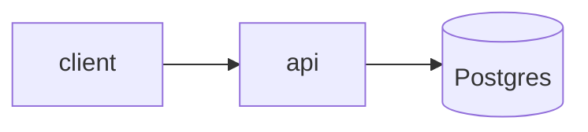

# Design: Publish pipeline

<!-- todo: delete this line once the design is written. The tracker marks Design done when it's gone. -->

## Requirements and numbers

- Users, requests per second, data size:
- The one number to hit:

## Diagram

## Decisions and trade-offs

| Decision | Chose | Rejected | Why |
|---|---|---|---|
| | | | |
